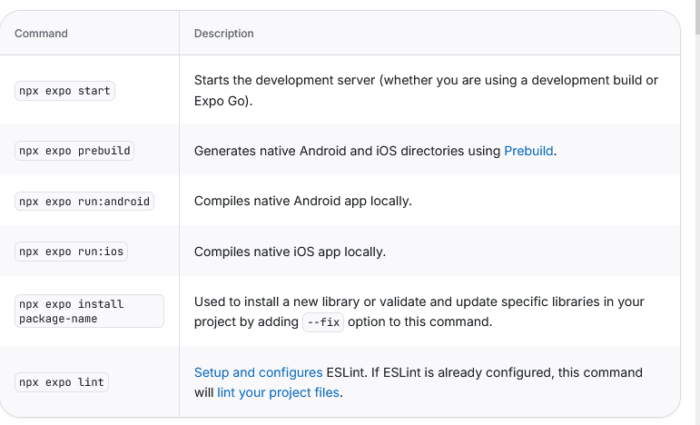

# Конспект
### Expo - это структура React Native, которая облегчает разработку приложений

### Системные требования 
    Node.js (LTS).
    Поддерживаются macOS, Windows (Powershell и WSL 2) и Linux.

Начинаем с проекта по умолчанию, источник рекомендует начать с create-expo-app. Проект по умолчанию включает в себя пример кода, чтобы помочь начать работу.

### чтобы создать новый проект:
    делаем в Терминале
    npx create-expo-app@latest --template default@sdk-58

### чтобы копировать:
    npx create-expo-app@latest --example

### Пример
    Вместо проекта по умолчанию можно начать с одного из примеров Expo. Это небольшие приложения, которое демонстрирует определенную функцию или интеграцию такие как Expo Router, Expo Widgets или экран камеры.

### Чтобы просмотреть полный список и выбрать один в интерактивном режиме, нужно запустить create-expo-app с опцией-примером и без имени:
    Делаем в Терминале
    npx create-expo-app@latest --example

### Чтобы настроить агента ИИ
    Новый проект включает AGENTS.md с контекстом проекта для Агентов ИИ. Когда установлен код Claude, он такде включает .claude/settings.json для включения плагина Expo. у Кодекса тоже есть. 
#### Установка с помощью одной команды в клоде #
    claude plugin install expo@claude-plugins-official

# 3ье задание (Лекционное №1)
Когда мы создаем новый проект в Expo, изучение следующих инструментов на вебсайтахх может помочь в разработке наших приложений. Эта страница показывает несколько рекомендуемых инструментов

## Expo CLI 
    Expo CLI инструмент разрабочика и устанавливается автоматически с EXPO распаковывается когда ты создаешь новый проект. Ты можешь вызывать его используя npx 

    Дизайн помогает тебе передвигаться быстрее между разработкой приложения. Например, твой первый выпуск с Expo CLI начнется и разработки сервера команды: 
#### npx expo start #

Продолжай с помощью обычного листа команд которые сделают твоё использование Expo CLI когда ты будешь рарзрабатывать своё приложение: 

